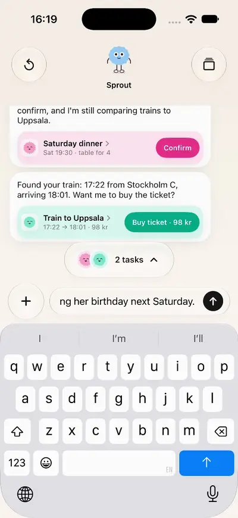

# Sprout

A personal assistant you text, with every task living as a small fuzzy character in a slider. Ask for something and a task is born, swipe through what's working, answer questions and confirm results in a glass sheet, and look back through six months of history.

<p align="center">
  
</p>

<p align="center"><a href="docs/demo.mp4">Watch as a video</a></p>

## Tech stack

- SwiftUI, iOS 26
- Liquid Glass (`glassEffect`, glass button styles)
- Swift Observation (`@Observable`)
- Scripted assistant behind an `AssistantService` protocol, no backend
- Character art as PNG assets, no animation library

## Run

```text
Open sprout-personal-assistant.xcodeproj in Xcode 26, choose an iPhone simulator on iOS 26 and press Run.
```
